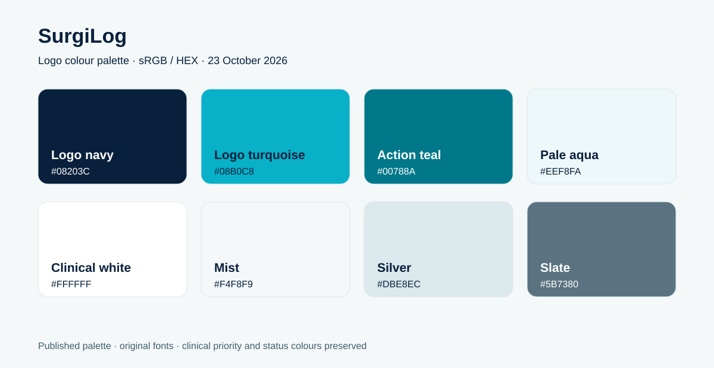

# SurgiLog — design and brand guide

Version 0.4 · Updated 16 October 2026 · Working brand for the app

This is the shared reference for the app, presentations, documents and future brand assets. It records the **current implementation** and gives **reuse guidance** for new work. Dylan leads development; Leo provides clinical/product direction. This is a working identity, not a completed institutional brand programme.

Use this guide instead of the earlier proposed palette in planning documents. Values marked **current** come from the repository. Guidance for external materials does not imply that every existing screen already follows it.

## Brand at a glance

| Item | Direction |
| --- | --- |
| Product name | **SurgiLog** — one word, with capital S and L |
| Product description | Surgical backlog and theatre tracking for South African hospital teams |
| Primary audience | Doctors, scrub sisters, clerks, scheduling teams and hospital managers |
| Current tagline | None in the application interface |
| Current headline | **Every patient. Every theatre. Every day.** |
| Supporting line | **Built for South African hospital teams** |
| Personality | Calm, clear, practical, trustworthy and human |
| Visual direction | Light blue and white, silver-grey structure, dark blue-grey text and restrained gold accents |
| Core idea | Help teams see waiting patients, organise theatre time and understand recorded treatment activity |

Keep the product name intact in hospital-specific materials: “SurgiLog · [Hospital name]”. Place hospital identity alongside it with a clear separator. Hospital names and departments are workspace context, not different product brands.

## Colour palette



### Core colours — current

Use HEX for digital work. RGB values below use sRGB. “Silver” is a flat cool grey, not a metallic finish.

| Name | HEX | RGB | Role / existing CSS |
| --- | --- | --- | --- |
| Theatre blue | `#176B9A` | `23, 107, 154` | Primary buttons, links, brand tile, browser theme; `--blue` |
| Clinical white | `#FFFFFF` | `255, 255, 255` | Cards, forms, navigation and reversed button text; `--surface` |
| Mist | `#F4F7FA` | `244, 247, 250` | Main application background |
| Pale blue | `#F0F6FA` | `240, 246, 250` | Login story background and information panels |
| Selected blue | `#EAF4FA` | `234, 244, 250` | Active navigation background |
| Silver | `#E3EAF0` | `227, 234, 240` | Panel borders and dividers; `--border` |
| Ink | `#203A4A` | `32, 58, 74` | Headings and strong text; `--ink` |
| Body ink | `#243949` | `36, 57, 73` | Default body text |
| Slate | `#748595` | `116, 133, 149` | Muted accents and secondary UI styling; `--muted` |
| Gold | `#B69048` | `182, 144, 72` | Restrained brand accent; `--gold` |
| Strong secondary text | `#42586A` | `66, 88, 106` | Existing secondary button text; preferred for readable small secondary copy in new materials |

**Reuse guidance:** let white and pale surfaces dominate. Use blue to direct attention to actions and navigation. Use gold for a small dot, rule, highlight or icon detail. Keep large areas of gold out of operational screens. A useful starting point for a presentation is roughly 80% light surfaces, 15% blue/ink and 5% gold or supporting accents; this is a composition guide, not a measured property of the app.

### Supporting colours — current

| Use | Value |
| --- | --- |
| Supplied logo artwork | Preserve the embedded blue, pale-blue, silver and navy gradients; do not sample one tint and redraw it as a flat substitute |
| Focus outline | `#88C4E9` |
| Main activity chart bars | `#3F91B8` |
| Gold metric icon / background | `#BF9A53` / `#FAF4E8` |
| Green metric icon / background | `#50927D` / `#EAF6F1` |
| Error text / background / border | `#A25349` / `#FCF0ED` / `#F3DDD5` |
| Pending-entry badge text / background | `#AE8B47` / `#FAF3E5` |
| Install splash background | `#F4F8FB` |

The supplied logo is the current brand master. Its artwork contains gradients and highlights beyond the flat interface palette. Preserve those values in the logo itself; use the core palette above for surrounding layouts rather than creating near-matching logo variants.

### Clinical and workflow colours

These are **current implementation values**, not a substitute for readable labels. Colour distinguishes concepts; the text carries the meaning.

| Priority label | Text | Background | Chart fill |
| --- | --- | --- | --- |
| P1 · ≤30 days | `#BE6559` | `#FBEEEA` | `#D4867A` |
| P2 · 31–90 days | `#AA874B` | `#FAF3E4` | `#CBB076` |
| P3 · 91–365 days | `#5C8EA9` | `#EDF5FA` | `#77A9C5` |

Always show the target range alongside the priority label, including on phones. Do not infer urgency from a colour or replace the target with an unlabeled dot. Priority policy is documented separately in [clinical priorities](docs/clinical-priorities.md).

| Workflow status | Current text | Current dot |
| --- | --- | --- |
| Waiting / default | `#82929E` | `#AAB8C1` |
| Scheduled | `#5488A8` | `#74A7C7` |
| In theatre | `#8873AD` | `#A38CC0` |
| Completed | `#508F7D` | `#6CAA94` |
| On hold | `#A68A57` | `#C4A96F` |

Keep clinical priority, case status, readiness and sync state visually separate. For example, a scheduled case can still be P1, and an offline completion can still be waiting to sync. Gold used decoratively is not itself a clinical status.

## Typography

| Role | Typeface | Weights currently bundled | Reuse guidance |
| --- | --- | --- | --- |
| Headings, wordmark, major numbers | **Manrope** | 600, 800 | 800 for prominent titles; 600 for supporting headings |
| Body, controls, tables, labels | **DM Sans** | 400, 600 | 400 for reading; 600 for emphasis and controls |
| Fallback | `system-ui, sans-serif` | Platform-dependent | Use when the brand fonts are unavailable |

Font references: [Manrope](https://fonts.google.com/specimen/Manrope), [DM Sans](https://fonts.google.com/specimen/DM+Sans). The application bundles local font files through Fontsource so they remain available offline. The installed packages include their font licence files; carry the relevant notices with redistributed font assets.

### Current type scale

| Element | Desktop size | Notes |
| --- | --- | --- |
| Login hero | 57px | Manrope; 48px/41px at narrower desktop/tablet breakpoints |
| Page heading | 31px | Manrope; 1.25 line-height; typically 25–26px on smaller screens |
| Login form heading | 25px | Manrope; 1.4 line-height |
| Dialog heading | 20px | 19px on small phones |
| General section heading | 18px | Panel titles use 16px |
| Main metric value | 34px | Typically 29–30px in narrower layouts |
| Base body | 14px | DM Sans |
| Buttons and form inputs | 12px | Existing compact application controls |
| Patient names / procedure text | 12px | Clinical labels stay visible on phones |
| Status / priority badge | 11px | Priority badge 10px on phones; target suffix 10px/9px |

The CSS also requests intermediate weights such as 650 and 750, while only the four static font weights above are bundled. Use the available 400/600/800 weights in new design files for predictable matching. A future font pass may standardise those CSS requests.

**Guidance for new material:** use sentence case, short headings and generous line spacing. Reserve uppercase and wide tracking for brief labels or the wordmark descriptor. Use 16px body copy for new public-facing web material and a comfortable reading size for print. Existing 8–11px helper text is a compact prototype detail, not the target for new patient-critical information or external documents.

## Logo, wordmark and icons


Dylan renamed the product to **SurgiLog** on 13 October 2026. The interface pairs the supplied mark—three masked theatre staff in front of an organised schedule—with a single-line SurgiLog wordmark in Manrope 800 and interface Ink. The original Theatre Tracker artwork remains untouched in the brand archive; its old lettering is no longer displayed in the application.

| Asset | Location | Use |
| --- | --- | --- |
| Horizontal master PNG | [docs/brand/logo-lockup-master.png](docs/brand/logo-lockup-master.png) | Original supplied Theatre Tracker artwork; historical archive |
| Square mark master PNG | [docs/brand/logo-mark-master.png](docs/brand/logo-mark-master.png) | Original supplied transparent artwork; archive and export source |
| Horizontal runtime PNG | [public/logo-lockup.png](public/logo-lockup.png) | Optimised source cropped at render time to show only the supplied theatre-team mark |
| Install icon, 192px | [public/icon-192.png](public/icon-192.png) | Small app-install asset |
| Install icon, 512px | [public/icon-512.png](public/icon-512.png) | Larger app-install asset |
| Live logo component | `Brand()` in [apps/web/ui.tsx](apps/web/ui.tsx) | Application placement and accessible product-name text |
| Colour swatches | [docs/brand-palette.svg](docs/brand-palette.svg) | Import into design tools or reference in a presentation |

The horizontal lockup uses a 26px wordmark in application navigation, a fluid 42–54px wordmark on desktop sign-in, and 36px on phone sign-in. The mark is two font-size units wide, followed by a 0.35em gap; wordmark letter spacing is −0.04em. Transparent source padding and the old lettering are cropped at render time so the visible mark aligns with the sign-in headline. SurgiLog is rendered as live text in interface Ink; the theatre-team mark retains its original colours. The PWA icons are exact proportional reductions of the supplied square master. The browser favicon and Apple touch icon use the 192px mark. There is not yet an approved vector, monochrome or reversed logo set.

**Reuse guidance:** keep at least one-quarter of the square mark’s width clear around it. Start with a minimum 32px mark, then check legibility at the final size. Use a clean white or pale-blue background. Keep the supplied proportions, transparency and colours intact. Resize from the archived master, without stretching or removing individual people from the mark. Use the supplied mark beside the new SurgiLog name, preserving the spelling and capitalisation. Use Manrope 800 and interface Ink for the wordmark; do not reuse the archived Theatre Tracker lettering in new materials.

UI icons come from **Lucide**, using simple outline strokes. Common sizes are 14–20px in controls and 20–24px for stronger emphasis. Pair unfamiliar icons with labels and give icon-only controls accessible names. Continue this outline style in supporting illustrations and presentation diagrams.

## Layout and component styling

The interface uses white cards on a cool pale canvas, thin dividers, modest rounding and very light shadows. Organise information around hospital/department context, a clear page title, the main action, and the relevant records or metrics.

### Current geometry

| Element | Current styling |
| --- | --- |
| Main sidebar | 239px; 208px at widths ≤1150px |
| Main content | Maximum 1650px; typical padding 31px vertically / 35px horizontally |
| Large desktop, ≥1500px | Content padding 40px / 48px |
| Phone content, ≤600px | 22px / 16px |
| Top bar | 70px; 60px at widths ≤850px |
| Panels / metric cards | 11px radius; 1px silver border; `0 3px 4px #344E6D02` shadow |
| Panel padding | 23px desktop; 27px large desktop; 19px phone |
| Buttons | 8px radius; primary blue with white text; 41px minimum height for the standard variant |
| Inputs | 8px radius; 1px `#DBE4EB` border; 42px minimum height; 10px / 12px padding |
| Icon buttons | At least 36px square after the final CSS override |
| Badges | 5px radius; 4px / 7px padding; text plus target/status |
| Dialogs | 15px radius; 470px standard / 710px wide, constrained to the viewport; maximum 90dvh |
| Dialog backdrop | `#112D4366` with 3px blur |
| Dialog shadow | `0 25px 100px #15334B30` |

The prototype uses optical spacing such as 17px, 21px and 23px; it does not yet implement a strict spacing-token scale. For new layouts, start with a **4px rhythm**: 4, 8, 12, 16, 24, 32 and 48px. Preserve the current values when reproducing an existing screen exactly.

### Responsive behaviour — current

The fixed navigation scrolls vertically on short screens and phone landscape so every section and Log out remain reachable.

| Viewport | Behaviour |
| --- | --- |
| ≥1500px | More generous padding and taller chart panels |
| ≤1150px | Narrower sidebar, smaller metric cards, some compact-table columns adapted |
| ≤850px | Sidebar becomes a menu drawer; main content uses the full width |
| ≤600px | Two-column metric grid; other dashboard grids and forms become single-column; login stacks vertically |

In new phone designs, prioritise the patient, procedure, priority target and next action. Keep the active hospital and department easy to identify. The app’s final CSS overrides restore both P1 target suffixes on phones; earlier rules that hide them are superseded.

### Component guidance

- **Actions:** one clear primary action per section. Use an outlined or text action for secondary work. Describe the action with a verb, such as “Add surgical case”.
- **Forms:** visible labels above fields, help below, errors next to the relevant work. Keep required clinical context explicit. Use the same field order across phone and desktop.
- **Tables:** quiet headers, subtle row separators and consistent alignment. Keep key clinical labels readable when the layout contracts.
- **Charts:** flat fills, light gridlines, labelled units and time periods. Distinguish unavailable measurements from zero. Keep a stable colour mapping across reports.
- **Empty states:** explain what is empty and the next useful action. “No pending entries” refers to the current workspace.
- **Saving and sync:** say “Saved on this device” until the server acknowledges the entry. Show actual offline or conflict states. There are no separate device-passphrase prompts, pre-release migration banners or old-workspace recovery screens.
- **Motion:** current button transitions are 160ms, drawer movement 200ms, and the sync spinner 1.3s per revolution. Reduced-motion preferences disable animations/transitions. Keep motion functional and restrained.

## Readability and accessibility

Use at least 4.5:1 contrast for normal text and 3:1 for qualifying large text. These are design targets, not a claim that the whole prototype passes an accessibility audit. [W3C contrast guidance](https://www.w3.org/WAI/WCAG22/Understanding/contrast-minimum.html).

The following ratios were calculated from the exact opaque sRGB values above against white:

| Pair | Approximate contrast | Reuse decision |
| --- | --- | --- |
| Blue `#176B9A` / white | 5.82:1 | Suitable for normal button/link text |
| Ink `#203A4A` / white | 11.89:1 | Preferred for readable headings and body copy |
| Strong secondary `#42586A` / white | 7.41:1 | Preferred for small secondary copy |
| Slate `#748595` / white | 3.80:1 | Does not meet the normal-text target |
| Gold `#B69048` / white | 2.97:1 | Use decoratively, not for readable text on white |

Some current small labels and pastel status badges need a contrast/readability pass. Keep their semantic hues, but use a darker text treatment in new designs and check the actual text/background pair. The app has a 3px light-blue focus outline; test its visibility on the final surface. Aim for at least 44px touch areas in new phone controls; the current compact controls are not all that large.

Always combine colour with words, icons or another distinguishable cue. This is especially important for urgency, errors and sync state. [W3C colour guidance](https://www.w3.org/WAI/WCAG22/Understanding/use-of-color.html).

## Brand voice, imagery and external materials

Use a visible **Log out** label and logout icon in the account area, rather than an unexplained padlock. Saved activity explains that logout deletes unsynced device entries.

Write in clear South African English: **theatre**, **prioritise**, **organisation** and **colour**. Use “patient”, “case”, “session” and “booking” precisely. State what happened and what the user can do next. Use calm, respectful language rather than alarmist or promotional claims.

| Context | Example |
| --- | --- |
| Product introduction | “A shared view of your surgical backlog, so your team can turn waiting into care.” |
| Navigation | “Surgical backlog”, “Theatre planning”, “Saved activity” |
| Action | “Add surgical case”, “View current case”, “Sync now” |
| Local save | “Saved on this device. Waiting for server acknowledgement.” |
| Empty state | “No pending entries” |

Show South African dates and operating times consistently, such as `04 Oct 2026` and `14:30`; use Africa/Johannesburg for the app. Keep the confirmed P1 ≤30 days, P2 31–90 days and P3 91–365 days ranges intact in diagrams and presentations.

The current app relies on typography, outline icons and data rather than photography. For future photography, favour natural light, hospital teamwork and respectful context. Use authorised imagery and synthetic patient records in mockups. Avoid graphic surgical imagery and decorative photos that compete with operational information.

**Suggested starting layouts for reuse:**

- **Presentation:** white background, blue title, ink body text, a narrow gold rule and the symbol in one consistent corner. Charts use the app’s semantic mappings.
- **Document/report:** a small wordmark, document title, hospital/department and reporting period. Use quiet borders and labelled tables; retain readable contrast in greyscale.
- **Website or announcement:** pale-blue field, Manrope headline, DM Sans body, a single blue primary action and restrained gold detail.
- **Print:** provide the vector asset and sRGB palette to the designer/printer for conversion with the actual print profile and a proof. No Pantone or CMYK brand standard has been defined.

## Copyable starting tokens

These portable names are aliases for the current core values, suitable for a new project or design-tool variables. They do not rename the application’s existing CSS variables.

```css
:root {
  --tt-blue: #176b9a;
  --tt-white: #ffffff;
  --tt-background: #f4f7fa;
  --tt-pale-blue: #f0f6fa;
  --tt-selected: #eaf4fa;
  --tt-border: #e3eaf0;
  --tt-ink: #203a4a;
  --tt-body: #243949;
  --tt-secondary-text: #42586a;
  --tt-muted: #748595;
  --tt-gold: #b69048;
  --tt-focus: #88c4e9;
  --tt-font-body: 'DM Sans', system-ui, sans-serif;
  --tt-font-heading: 'Manrope', system-ui, sans-serif;
  --tt-radius-control: 8px;
  --tt-radius-card: 11px;
  --tt-radius-dialog: 15px;
}
```

## Maintaining consistency

The local Theatre register and Performance extension uses the same white panels, mist background, Ink headings and standard inputs/buttons. Register rows expose Draft/Verified as text; status is never conveyed by colour alone. Dates/times identify SAST and reporting scope. Charts use primary blue `#176b9a` for counts, green `#50927d` for utilisation, restrained gold `#b69048` for turnaround and muted blue `#6a9ab5` for first entry. Unknown/future observations stay blank. Tables wrap headings and names; report columns fit their panels instead of inheriting the wide patient-table layout. On phones, charts/breakdowns stack in one column and KPI cards use two columns. The executive print view omits navigation/controls, keeps hospital/department/period/generated time and metric definitions, and contains aggregates only. These patterns add no new brand identity.

Keep this file, the palette SVG and the app styles aligned when a design decision changes. Update current values explicitly; label new proposals until implemented. Link approved new logo variants here when created. Dark mode, vector/monochrome/reversed logo exports, print specifications and a full accessibility pass remain future design work.

Implementation references: [styles](apps/web/styles.css), [shared UI and wordmark](apps/web/ui.tsx), [login copy](apps/web/Login.tsx), [fonts and chart colours](apps/web/main.tsx), [install manifest configuration](vite.config.ts). The original Claude artifact remains a product reference; this guide describes the current application’s visual identity.
